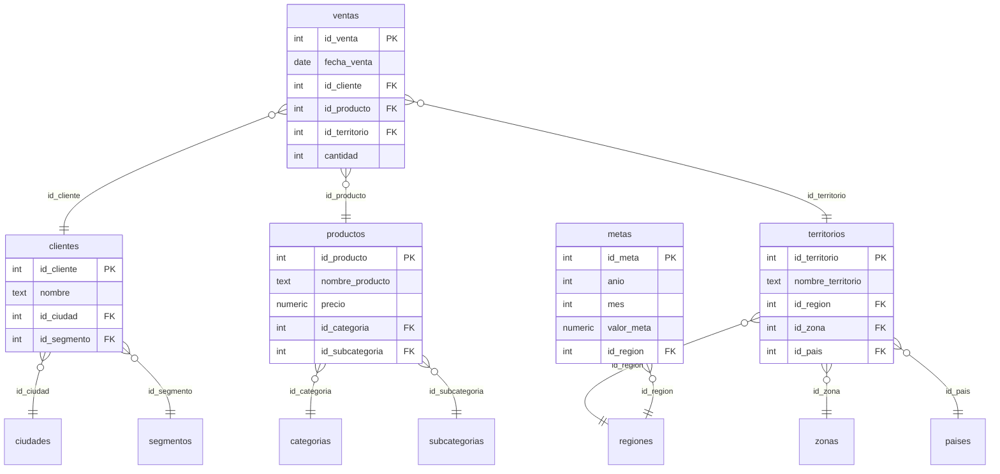

# 🛒 RetailPro

> Modelo de datos relacional y analítico para una empresa de **retail tecnológico**, construido en **PostgreSQL** y explotado en **Power BI / DAX**.


---

## 📑 Tabla de contenidos

1. [Descripción general](#-descripción-general)
2. [Estructura de la base de datos y modelo relacional](#️-estructura-de-la-base-de-datos-y-modelo-relacional)
3. [Requisitos previos y stack tecnológico](#-requisitos-previos-y-stack-tecnológico)
4. [Guía paso a paso: clonar y ejecutar los scripts](#-guía-paso-a-paso-clonar-y-ejecutar-los-scripts)
5. [Estructura del repositorio](#-estructura-del-repositorio)
6. [Autor](#-autor)

---

## 📌 Descripción general

**RetailPro** es un proyecto de análisis de datos que simula el entorno de una empresa de retail tecnológico (laptops, monitores, periféricos, almacenamiento, etc.). Cubre el ciclo analítico completo, desde el modelado relacional hasta la visualización:

- **Modelado relacional** en PostgreSQL (base de datos `Ventas_Tech_DB`), con una tabla de hechos (`ventas`) y sus dimensiones asociadas.
- **Consultas de negocio en SQL** (agregaciones, filtros, agrupaciones y rankings) para responder preguntas comerciales.
- **Consultas avanzadas con `JOIN` y `UNION`** para consolidar datos de múltiples entidades.
- **Modelo semántico en Power BI** con medidas DAX para KPIs clave: facturación, ticket promedio, cumplimiento de metas, entre otros.

Este proyecto fue desarrollado como parte del curso de **Data Analytics de Coderhouse**.

🔗 **Repositorio:** [github.com/JuanJoseGuiboHiga/retailpro-coderhouse](https://github.com/JuanJoseGuiboHiga/retailpro-coderhouse)

### ✨ Qué puedes hacer con este proyecto

- Analizar la facturación por producto, categoría, cliente, territorio y periodo temporal.
- Medir el desempeño y el porcentaje de cumplimiento frente a metas comerciales.
- Identificar concentración de ingresos y brechas entre volumen físico y valor monetario.
- Utilizar la base de datos como fuente centralizada para tableros interactivos en Power BI.

---

## 🗄️ Estructura de la base de datos y modelo relacional

La base de datos **`Ventas_Tech_DB`** está compuesta por **1 tabla de hechos** y **11 tablas de dimensiones**, organizadas en tres jerarquías principales: **Cliente**, **Producto** y **Territorio / Desempeño**.

### Tabla de hechos

| Tabla | Descripción |
|---|---|
| `ventas` | Transacciones comerciales: fecha, cantidad y claves foráneas hacia cliente, producto y territorio. |

### Dimensiones

| Dimensión | Jerarquía | Descripción |
|---|---|---|
| `clientes` | Cliente | Datos del cliente; se relaciona con ciudad y segmento. |
| `ciudades` | Geografía del cliente | Ciudad de residencia del cliente. |
| `segmentos` | Cliente | Segmento comercial del cliente. |
| `productos` | Producto | Catálogo de productos con su precio unitario. |
| `categorias` | Producto | Categoría principal del producto. |
| `subcategorias` | Producto | Subcategoría asociada a una categoría. |
| `territorios` | Territorio | Territorio comercial de la venta; vinculado a región, zona y país. |
| `regiones` | Territorio | Región a la que pertenece el territorio. |
| `zonas` | Territorio | Zona geográfica del territorio. |
| `paises` | Territorio | País al que pertenece el territorio comercial. |
| `metas` | Desempeño | Objetivos comerciales definidos por región, año y mes. |

### Diagrama entidad-relación



### Vista analítica base

Une la tabla de hechos con sus dimensiones para generar la base consolidada del análisis:

```sql
SELECT
    v.id_venta,
    v.fecha_venta,
    c.nombre                AS nombre_cliente,
    ci.nombre               AS ciudad_cliente,
    s.nombre                AS segmento_cliente,
    p.nombre_producto       AS descripcion_producto,
    cat.nombre_categoria,
    sub.nombre_subcategoria,
    t.nombre_territorio,
    r.nombre_region,
    z.nombre_zona,
    pa.nombre_pais,
    v.cantidad,
    p.precio                AS precio_unitario,
    (v.cantidad * p.precio) AS total_venta
FROM ventas AS v
INNER JOIN clientes      AS c   ON v.id_cliente      = c.id_cliente
INNER JOIN ciudades      AS ci  ON c.id_ciudad       = ci.id_ciudad
INNER JOIN segmentos     AS s   ON c.id_segmento     = s.id_segmento
INNER JOIN productos     AS p   ON v.id_producto     = p.id_producto
INNER JOIN categorias    AS cat ON p.id_categoria    = cat.id_categoria
INNER JOIN subcategorias AS sub ON p.id_subcategoria = sub.id_subcategoria
INNER JOIN territorios   AS t   ON v.id_territorio   = t.id_territorio
INNER JOIN regiones      AS r   ON t.id_region       = r.id_region
INNER JOIN zonas         AS z   ON t.id_zona         = z.id_zona
INNER JOIN paises        AS pa  ON t.id_pais         = pa.id_pais;
```

> 💡 **Nota de rendimiento:** con volúmenes grandes de datos se recomienda indexar las claves foráneas, particionar por fecha y materializar la vista o desnormalizar a un esquema en estrella.

---

## 🧰 Requisitos previos y stack tecnológico

### Stack tecnológico

| Capa | Herramienta |
|---|---|
| Base de datos / DWH | **PostgreSQL** |
| Cliente SQL | **DBeaver** o **pgAdmin** |
| Visualización y modelado semántico | **Power BI Desktop** |
| Lenguaje de medidas | **DAX** |
| Control de versiones | **Git** y **GitHub** |

### Requisitos previos

- [PostgreSQL](https://www.postgresql.org/download/) 14 o superior, instalado y en ejecución.
- Un cliente SQL: [DBeaver](https://dbeaver.io/download/) o [pgAdmin](https://www.pgadmin.org/download/).
- [Git](https://git-scm.com/downloads) instalado.
- [Power BI Desktop](https://powerbi.microsoft.com/desktop/) (solo Windows) para abrir el reporte analítico.
- Un usuario de PostgreSQL con permisos para crear bases de datos y tablas.

---

## 🚀 Guía paso a paso: clonar y ejecutar los scripts

### 1. Clonar el repositorio

```bash
git clone https://github.com/JuanJoseGuiboHiga/retailpro-coderhouse.git
cd retailpro-coderhouse
```

### 2. Crear la base de datos

Desde `psql` (con comillas dobles para respetar las mayúsculas del identificador):

```bash
psql -U postgres -c "CREATE DATABASE \"Ventas_Tech_DB\";"
```

O desde DBeaver / pgAdmin: clic derecho en *Databases* → *Create* → nombre `Ventas_Tech_DB`.

> ℹ️ Si `01_ventas_tech_db.sql` ya incluye la sentencia `CREATE DATABASE`, puedes omitir este paso.

### 3. Ejecutar los scripts en orden

Los scripts **deben ejecutarse en este orden**:

| Orden | Script | Qué hace |
|:---:|---|---|
| 1️⃣ | `sql/01_ventas_tech_db.sql` | Crea la estructura de la base de datos (tablas, PK y FK) y carga los datos de dimensiones y hechos. |
| 2️⃣ | `sql/02_m4_consultas_negocio.sql` | Consultas de negocio: agregaciones, filtros, agrupaciones y rankings (Módulo 4). |
| 3️⃣ | `sql/03_m5_consultas_join_union.sql` | Consultas relacionales con `JOIN` y `UNION` (Módulo 5). |

**Opción A: línea de comandos (`psql`)**

```bash
psql -U postgres -d Ventas_Tech_DB -f sql/01_ventas_tech_db.sql
psql -U postgres -d Ventas_Tech_DB -f sql/02_m4_consultas_negocio.sql
psql -U postgres -d Ventas_Tech_DB -f sql/03_m5_consultas_join_union.sql
```

**Opción B: DBeaver / pgAdmin**

1. Conéctate a la base de datos `Ventas_Tech_DB`.
2. Abre cada archivo con *File → Open File* (o *Query Tool* en pgAdmin).
3. Ejecútalos en orden (`Alt + X` en DBeaver para ejecutar el script completo).

### 4. Verificar la carga

```sql
SELECT COUNT(*) AS total_ventas FROM ventas;

SELECT table_name
FROM information_schema.tables
WHERE table_schema = 'public'
ORDER BY table_name;
```

Deberías ver las 12 tablas del modelo y registros cargados en `ventas`.

### 5. Conectar Power BI (opcional)

1. Abre Power BI Desktop → *Obtener datos* → *Base de datos PostgreSQL*.
2. Ingresa el servidor (`localhost`) y la base de datos (`Ventas_Tech_DB`).
3. Selecciona las tablas o la vista base y carga los datos.
4. Verifica las relaciones en la vista *Modelo* y crea las medidas DAX.

### 🛠️ Solución de problemas

| Problema | Posible solución |
|---|---|
| `database "Ventas_Tech_DB" does not exist` | Crea la base de datos antes de ejecutar los scripts (paso 2) y respeta las mayúsculas usando comillas dobles. |
| Errores de clave foránea al cargar datos | Ejecuta primero `01_ventas_tech_db.sql` y respeta el orden secuencial de los scripts. |
| `permission denied` | Usa un usuario con privilegios de creación o ejecuta como `postgres`. |
| Power BI no conecta | Instala el conector Npgsql o verifica host, puerto (`5432`) y credenciales. |

---

## 📁 Estructura del repositorio

```text
retailpro-coderhouse/
├── sql/
│   ├── 01_ventas_tech_db.sql           # Estructura de la BD y carga de datos
│   ├── 02_m4_consultas_negocio.sql     # Consultas de negocio (Módulo 4)
│   └── 03_m5_consultas_join_union.sql  # Consultas JOIN y UNION (Módulo 5)
├── powerbi/
│   ├── GuiboHiga_JuanJose_Checkpoint2.pbix  # ETL en Power Query (M) y preparación del modelo
│   └── Pipeline_ETL_GuiboHiga_JuanJose.pbix  # Reporte final, medidas DAX y tableros
├── .gitignore
├── LICENSE
└── README.md
```

---

## 👤 Autor

**Juan José Guibo Higa**
Curso: **Data Analytics — Coderhouse**

- 🐙 GitHub: [@JuanJoseGuiboHiga](https://github.com/JuanJoseGuiboHiga)
- 🔗 Repositorio: [retailpro-coderhouse](https://github.com/JuanJoseGuiboHiga/retailpro-coderhouse)

---

⭐ Si este proyecto te resultó útil, ¡no olvides darle una estrella al repositorio!
